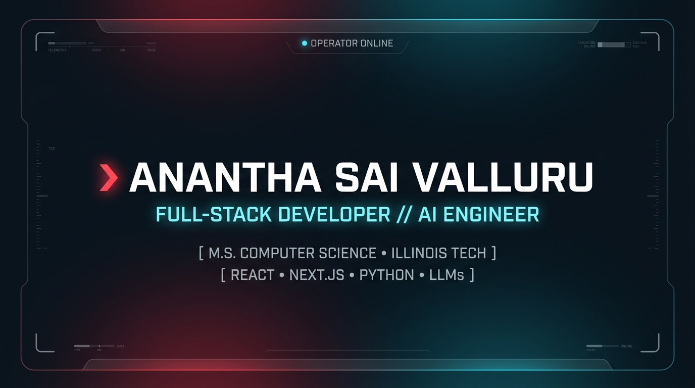

<div align="center">

# ⌘ Anantha Sai Valluru
### Tactical Terminal — Interactive Developer Portfolio

[](https://nextjs.org/)
[](https://www.typescriptlang.org/)
[](https://ai.google.dev/)
[](https://www.mongodb.com/)
[](https://www.framer.com/motion/)
[](https://asv-dev.vercel.app)

<p align="center">
  Not a static resume page — a live, terminal-themed application with a real AI assistant,<br/>
  a database-backed content layer, and a command palette that actually does things.
</p>

[🚀 Launch Live Site](https://asv-dev.vercel.app)

</div>

---



## What makes this different

Most developer portfolios are static marketing pages. This one is a working full-stack application: an embedded AI assistant answers real questions about my background in-character as a tactical terminal, a `Cmd/Ctrl+K` command palette drives real actions (not just navigation), and the Experience/Projects/Education sections are pulled live from MongoDB — updating the content is a database write, not a redeploy.

## Features

| Feature | Description |
|---|---|
| 🤖 **AI Operator Uplink** | `/ask` queries a Gemini-powered assistant with full context on my background, projects, and skills — answers in-character as a tactical terminal readout |
| ⌨️ **Command Palette** | `Cmd/Ctrl+K` opens a real command interface: `/ask`, `/socials`, `/resume`, `/reset` — not decorative, each one does something |
| 🗄️ **Live Data Layer** | Experience, Projects, and Education are fetched from MongoDB via Mongoose, not hardcoded |
| 🎬 **Dynamic Boot Sequence** | Decrypting text headers, typewriter terminal output, and staged reveal animations on load |
| 📡 **Kill-Feed Notifications** | Event-driven, terminal-style toast system for in-app actions |
| 🎯 **Custom Cursor & Magnetic UI** | A reactive crosshair cursor and magnetic hover effects on interactive elements |
| 🥚 **Hidden Easter Egg** | Type a certain 5-letter word anywhere on the page. See what happens. |
| ✉️ **Direct Contact** | Secure client-to-server messaging via EmailJS — no exposed mail credentials |

## Tech Stack

- **Frontend:** Next.js (App Router), React 19, TypeScript
- **AI:** Google Gemini API (`@google/generative-ai`)
- **Animation:** Framer Motion, Lenis smooth scroll
- **Database:** MongoDB with Mongoose
- **Styling:** Tailwind CSS, custom CSS (scanlines, grid overlays)
- **Messaging:** EmailJS
- **Icons:** Lucide React

## Project Structure

```
portfolio-main/
├── public/
│   └── og-image.png       # Open Graph preview image (1200x630 tactical social card)
├── src/
│   ├── app/
│   │   ├── api/ask/       # Gemini-powered AI assistant endpoint
│   │   └── page.tsx
│   ├── components/
│   │   ├── CommandPalette.tsx   # Cmd/Ctrl+K terminal command interface
│   │   ├── EntryDossier.tsx     # Boot sequence / hero section
│   │   ├── KillFeed.tsx         # Event-driven notification system
│   │   ├── EasterEgg.tsx        # Hidden keyboard-triggered animation
│   │   └── ...                  # Section components (About, Experience, Projects, etc.)
│   ├── lib/mongodb.js      # Database connection
│   └── models/             # Mongoose schemas (Experience, Education, Projects, SkillSector)
└── .env.local              # API keys and DB connection string (git-ignored)
```

## Local Setup

```bash
git clone https://github.com/Ananth-Sai/portfolio.git
cd portfolio
npm install
```

Create `.env.local`:
```
MONGODB_URI=your_mongodb_connection_string
GEMINI_API_KEY=your_gemini_api_key
NEXT_PUBLIC_EMAILJS_SERVICE_ID=your_service_id
NEXT_PUBLIC_EMAILJS_TEMPLATE_ID=your_template_id
NEXT_PUBLIC_EMAILJS_PUBLIC_KEY=your_public_key
```

```bash
npm run dev
```

Open `http://localhost:3000`.

## Try it

- Press `Cmd/Ctrl+K` to open the terminal command palette
- Type `/ask` followed by a question about my background or projects
- Type `/socials` for direct contact links
- There's a hidden easter egg somewhere on the page — try typing while you scroll

## License

MIT
